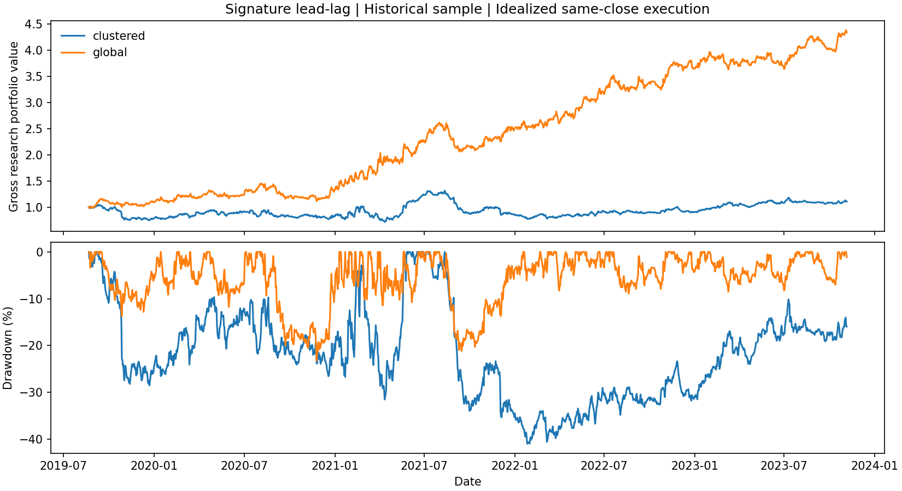

# Signature lead-lag networks

Daily cryptocurrency lead-lag research using level-two path signatures, directed networks and spectral clustering. The global portfolio follows recent leaders through a basket of followers, offset by a hedge across the observable universe.

The recorded sample has 57 assets and runs from 21 August 2019 to 5 November 2023. These are historical research results on the source project's dataset, not an independent holdout or live track record.

| Portfolio | Gross Sharpe | Gross Sharpe, 2% cash-rate assumption | Maximum drawdown |
|---|---:|---:|---:|
| Global lead-lag | 1.41 | 1.34 | -23.21% |
| Spectral clustering, absolute-degree normalization | 0.22 | 0.15 | -40.95% |

Sharpe uses arithmetic daily mean divided by sample standard deviation, annualized by sqrt(365.25). Gross means no transaction, funding or borrowing costs. The zero-delay convention assumes execution at the same close used to form the signal. Dollar-neutral weights do not establish market-beta neutrality.



## Execution sensitivity

At 5 bps per traded dollar, the global portfolio's Sharpe falls to 0.14. With one additional day of execution delay, its gross Sharpe is -0.10. Average one-way turnover is about 190% of NAV per day. The historical signal is therefore not evidence of a profitable executable strategy under those assumptions.

All combinations of zero/one additional day and 0/5/10/20 bps costs are in [scores.csv](artifacts/scores.csv). Costs use post-fee target notionals and include initial entry and final liquidation. Funding and borrow availability remain unmodeled, including in the fee scenarios. Missing marks are carried forward for valuation; this does not establish executable prices.

## Method

Each decision uses the latest 30 daily returns, standardized within that window. A level-two signature gives an antisymmetric Lévy-area matrix. Its row means rank assets; the top and bottom 20% are leaders and followers. The sign of the leaders' latest average return determines the direction of the follower-minus-universe portfolio. Eligibility and hedge membership use information observed by the decision date.

The spectral variant builds `H = i D^(-1/2) S D^(-1/2)`, with `D[j,j] = sum_k abs(S[j,k])`. This preserves Hermitian symmetry. Real and imaginary eigenvector coordinates feed seeded K-means; a silhouette score chooses 3–10 clusters using the historical window alone. Leaders and followers are then collected within clusters. That variant does not improve this sample.

## Replication and changes

The starting point is [ARahimiQuant/lead-lag-portfolios](https://github.com/ARahimiQuant/lead-lag-portfolios), pinned at `e02c2fbd62b8d823bbb605b6234a88a565fafee6`. Its global portfolio was reproduced at 1.43 using its CAGR-based Sharpe convention, close to the reported 1.42. Using arithmetic daily returns and the source's 2% rate gives 1.32. Those convention differences are recorded in [upstream_reproduction.csv](artifacts/upstream_reproduction.csv).

Changes here are the vectorized exact signature calculation, absolute-degree spectral normalization, a hedge universe observed at decision time, explicit execution/fee accounting and numerical tests. The source's signed complex-degree normalization is not Hermitian; the measured defect is recorded in [upstream_audit.json](artifacts/upstream_audit.json). Its advertised 1.95 clustered Sharpe is not claimed as reproduced.

## Run

```bash
python -m venv .venv
# Activate the environment, then:
python -m pip install -r requirements.txt
python -m pip install -e '.[dev]'
python -m pytest -q
python -m leadlag.research
```

The runner downloads the pinned price CSV and checks its SHA-256. Raw prices remain in an ignored cache. Rebuilding clustered targets takes several minutes. The [executed notebook](notebooks/research.ipynb) reads the recorded results, including subperiods and block-bootstrap intervals. Target weights, daily returns and the run manifest are in `artifacts/`.

The original MIT copyright is retained in [LICENSE](LICENSE). The method's references include [Bennett, Cucuringu and Reinert](https://arxiv.org/abs/2201.08283) and [Chevyrev and Kormilitzin](https://arxiv.org/abs/1603.03788). Availability of the source CSV does not establish rights to redistribute or commercially use its underlying market data.
