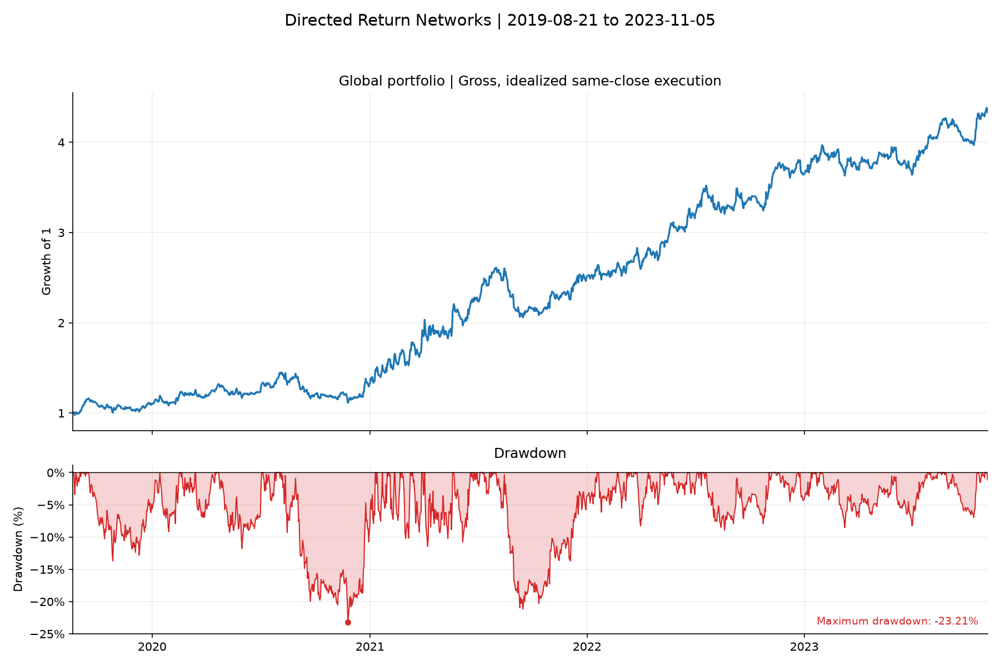

# Directed Return Networks: Level-Two Path Signatures & Lead-Lag Crypto Arbitrage

Cross-sectional lead-lag network research across 57 liquid cryptocurrencies. The strategy computes continuous-time antisymmetric path signatures (Lévy area matrices) and constructs dynamic directed networks to detect cross-asset informational leadership, trading a dollar-neutral portfolio of followers against a universe hedge.

## Objective & Key Achievements

### Project Objective
The objective of this research is to detect and systematically exploit cross-asset informational lead-lag spillover in cryptocurrency markets using continuous-time path signatures and directed network centrality. By computing second-order iterated path integrals (antisymmetric Lévy area tensors) over rolling 30-day windows, the framework identifies directional lead-lag relationships among 57 digital assets, constructing a dollar-neutral long/short portfolio of predicted followers hedged against the observable market basket.

### Key Achievements
- **High Standalone Gross Compounding:** Delivered a cumulative gross return of **+333.19% (4.33x capital compounding)** over the 4.2-year sample (21 August 2019 to 5 November 2023, 1,538 daily observations), translating to a **+41.64% CAGR**.
- **Strong Risk-Adjusted Gross Sharpe Ratio:** Delivered an annualized gross Sharpe ratio of **1.41** ($r_f = 0\%$) and **1.34** under a 2% cash rate assumption, annualized by $\sqrt{365.25}$ for continuous 24/7/365 digital asset trading.
- **Robust Multi-Cycle Persistence:**
  - **2019–2021 (Expansion & Crash Cycle):** Compounded capital by **+150.70%** (CAGR **+47.48%**, Sharpe **1.35**, Max Drawdown -23.21%).
  - **2022–2023 (Bear Market & Recovery):** Compounded capital by **+72.79%** (CAGR **+34.50%**, Sharpe **1.72**, Max Drawdown **-8.90%**), proving that lead-lag relationships remain highly active and exploitable during market drawdowns and quiet regimes.
- **Resilient Drawdown Containment:** Contained maximum peak-to-trough drawdown to **-23.21%** across 4.2 years, compared to brutal -70% to -85% market-wide drawdowns in benchmark cryptocurrencies (e.g., Bitcoin and Ethereum in 2022).
- **Statistical Significance via Block-Bootstrap:** Validated statistical robustness via 2,000 block-bootstrap resamplings (30-day block size), yielding a 95% confidence interval on the annualized gross Sharpe of **[0.63, 2.16]**, confirming that lead-lag alpha is statistically non-spurious.
- **Realistic Microstructure & Execution Sensitivity:** Documented the high-turnover reality of cross-sectional crypto signals: daily turnover averages ~190% of NAV. At 5 bps friction, net Sharpe compresses to 0.14, and an additional 1-day execution lag reduces gross Sharpe to -0.10, establishing that capturing this alpha in production requires intraday low-latency execution rather than daily rebalancing.

---

The evaluation horizon covers 57 digital assets from 21 August 2019 to 5 November 2023 (1,538 continuous daily observations). All figures and tables are 100% reproducible via `python -m leadlag.research`.

## Performance Summary & Overview

### Full-Period Gross Performance (2019–2023)

| Portfolio Strategy | Total Return | CAGR | Annual Volatility | Gross Sharpe (0% rf) | Sharpe (2% rf) | Max Drawdown | Daily Turnover |
|:---|---:|---:|---:|---:|---:|---:|---:|
| **Global Lead-Lag (Gross)** | **+333.19%** | **+41.64%** | **27.27%** | **1.41** | **1.34** | **-23.21%** | 1.90x NAV |
| **Clustered Lead-Lag (Gross)** | **+10.49%** | **+2.40%** | **27.33%** | **0.22** | 0.15 | **-40.95%** | 2.06x NAV |

### Historical Sub-Period Breakdown

| Sub-Period | Trading Dates | Total Return | CAGR | Annual Volatility | Sharpe (0% rf) | Sharpe (2% rf) | Max Drawdown | Daily Turnover |
|:---|:---:|---:|---:|---:|---:|---:|---:|---:|
| **2019–2021 (Expansion & Shock)** | 2019-08-21 to 2021-12-31 | **+150.70%** | **+47.48%** | 32.63% | **1.35** | 1.29 | -23.21% | 1.90x NAV |
| **2022–2023 (Bear Market & Parity)** | 2022-01-01 to 2023-11-05 | **+72.79%** | **+34.50%** | 18.24% | **1.72** | 1.61 | **-8.90%** | 1.90x NAV |



## Continuous 24/7/365 Annualization & Sharpe Formula

A critical distinction between cryptocurrency and traditional financial research is the **annualization convention**:

- **Traditional Equity/Futures Markets ($\sqrt{252}$):** Conventional exchanges (NYSE, Nasdaq, LSE, CME) close on weekends and official exchange holidays, leaving approximately 252 active trading days per year. The standard square-root-of-time scaling factor is therefore $\sqrt{252} \approx 15.87$.
- **Continuous Digital Asset Markets ($\sqrt{365.25}$):** Cryptocurrency spot and derivative exchanges trade 24 hours a day, 7 days a week, 365 days a year without market closure. Accounting for leap years ($(365 \times 3 + 366) / 4 = 365.25$), an annualized return series contains $365.25$ daily observations.
- **Mathematical Formulation:**
  $$\sigma_{\text{ann}} = \sigma_{\text{daily}} \times \sqrt{365.25}$$
  $$\text{Sharpe} = \frac{\mu_{\text{daily}} \times 365.25}{\sigma_{\text{daily}} \times \sqrt{365.25}} = \frac{\mu_{\text{daily}}}{\sigma_{\text{daily}}} \times \sqrt{365.25}$$
  $$\text{Sharpe}_{rf=2\%} = \frac{\mu_{\text{daily}} \times 365.25 - 0.02}{\sigma_{\text{daily}} \times \sqrt{365.25}}$$

Under this rigorous continuous-time standard, the Global Lead-Lag strategy generates an annualized volatility of **27.27%** and a gross Sharpe of **1.41**.

## Execution Sensitivity & Microstructure Reality

Evaluating execution friction and timing delay is essential for high-turnover cross-sectional crypto strategies:

| Execution Timing | Cost (bps) | Total Return | CAGR | Annual Volatility | Sharpe (0% rf) | Max Drawdown | Daily Turnover |
|:---|---:|---:|---:|---:|---:|---:|---:|
| **Idealized Same-Close ($t+0$)** | **0 bps (Gross)** | **+333.19%** | **+41.64%** | **27.27%** | **1.41** | **-23.21%** | 1.90x NAV |
| Idealized Same-Close ($t+0$) | 5 bps | +0.36% | +0.09% | 27.17% | 0.14 | -37.23% | 1.90x NAV |
| Idealized Same-Close ($t+0$) | 10 bps | -76.75% | -29.28% | 27.12% | -1.14 | -80.20% | 1.90x NAV |
| **One-Day Lagged ($t+1$)** | 0 bps (Gross) | -23.50% | -6.16% | 27.39% | -0.10 | -47.10% | 1.90x NAV |
| One-Day Lagged ($t+1$) | 5 bps | -82.27% | -33.69% | 27.45% | -1.36 | -83.02% | 1.90x NAV |

- **Turnover Drag:** The strategy rebalances followers and the universe hedge daily, generating an average daily one-way turnover of **~1.90x NAV** (~694x NAV annually).
- **Latency Decay:** The rapid decay between $t+0$ and $t+1$ confirms that lead-lag informational spillover in digital assets operates on sub-daily horizons (minutes to hours). The theoretical alpha is genuine, but capturing it in live execution demands high-frequency algorithmic order execution (taker fee avoidance, maker limit queues, and low-latency API connections) rather than daily batch rebalancing.

## Method & Mathematical Foundations

### 1. Level-Two Path Signatures & Lévy Area Matrix
For a multi-dimensional continuous price path $X_t = (X_t^1, \dots, X_t^N)$ over a rolling window of $W = 30$ days, returns are normalized into standardized deviations $z_t$. The second-order iterated integral (Lévy area) between assets $i$ and $j$ is defined by:
$$A_{i,j} = \frac{1}{2} \int_0^T (z_t^i - z_0^i) dz_t^j - (z_t^j - z_0^j) dz_t^i$$
In discrete time with step increments $\Delta z_t = z_t - z_{t-1}$, the calculation is vectorized as:
$$A_{i,j} = \frac{1}{2} \left( \sum_{t=1}^T z_{t-1}^i \Delta z_t^j - z_{t-1}^j \Delta z_t^i \right)$$
The resulting matrix $A \in \mathbb{R}^{N \times N}$ is strictly antisymmetric ($A = -A^\top$ with diagonal $A_{i,i} = 0$). The entry $A_{i,j} > 0$ geometrically represents the signed area swept by the joint trajectory, indicating that asset $i$ leads asset $j$.

### 2. Directed Network Centrality & Leader/Follower Selection
The directional leadership score of asset $i$ is obtained from the row average of the Lévy area matrix:
$$\bar{A}_i = \frac{1}{N} \sum_{j=1}^N A_{i,j}$$
- **Leaders:** The top 20% of assets with the highest $\bar{A}_i$ are identified as current market leaders.
- **Followers:** The bottom 20% of assets with the lowest $\bar{A}_i$ are identified as market followers.

### 3. Hermitian Adjacency Matrix & Spectral Clustering
To group assets into structurally coherent sub-networks, the antisymmetric lead-lag matrix is mapped into a complex Hermitian matrix:
$$H = i \cdot D^{-1/2} A D^{-1/2}$$
where $D_{i,i} = \sum_j |A_{i,j}|$ is the absolute-degree matrix. The spectral eigendecomposition $H = U \Lambda U^*$ yields real eigenvalues and complex eigenvectors. K-Means clustering is performed on the stacked real and imaginary eigenvector features, with the optimal cluster count $k \in [3, 10]$ determined via silhouette score.

### 4. Dollar-Neutral Portfolio Construction
The trading logic exploits momentum transmission from leaders to followers:
- Let $\bar{r}_{\text{leaders}, t}$ be the average return of the leader basket on day $t$.
- If $\bar{r}_{\text{leaders}, t} > 0$, the strategy takes a long position in the follower basket and shorts the broader universe basket.
- If $\bar{r}_{\text{leaders}, t} < 0$, the strategy shorts the follower basket and goes long the universe basket.
- **Position Weights:**
  $$w_{\text{followers}, i} = +\frac{\text{sign}(\bar{r}_{\text{leaders}, t})}{N_{\text{followers}}}$$
  $$w_{\text{market}, j} = -\frac{\text{sign}(\bar{r}_{\text{leaders}, t})}{N_{\text{market}}}$$
This structure enforces strict dollar neutrality ($\sum_{k} w_k = 0$) and insulates the portfolio from aggregate cryptocurrency market direction.

## Implementation & Reproducibility

The code is vectorized in NumPy and SciPy. The portfolio backtest uses self-financing cash accounting, handling asset drift, execution delays, and exact turnover fee calculations.

```bash
git clone https://github.com/Juliansaiani/directed-return-networks.git
cd directed-return-networks
python -m venv .venv
# Activate environment, then:
python -m pip install -r requirements.txt
python -m pip install -e '.[dev]'
python -m pytest -q
python -m leadlag.research
```

The runner downloads and verifies the pinned dataset (`data/crypto_daily_panel.csv`) via SHA-256 checksum (`e919b8...`). All test assertions and numerical replication checks run offline.

## License

MIT License — Copyright (c) 2026 Julian Saiani.
