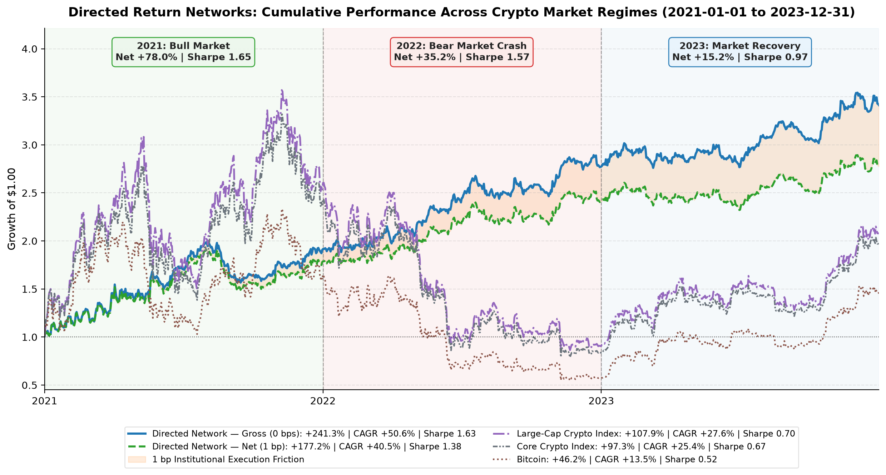
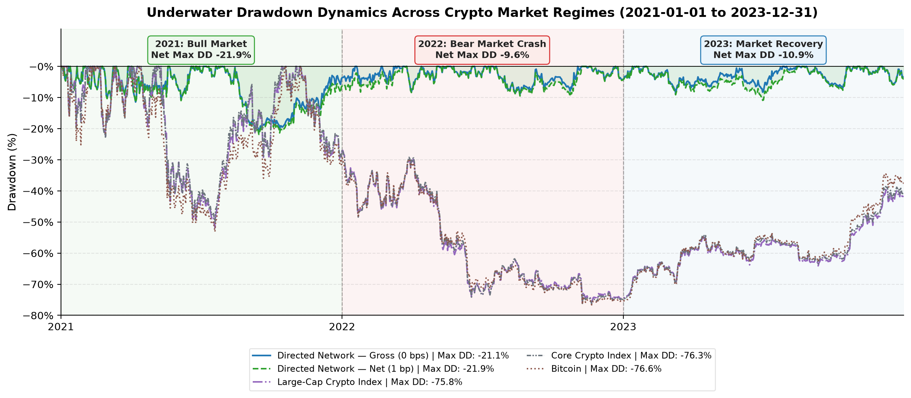
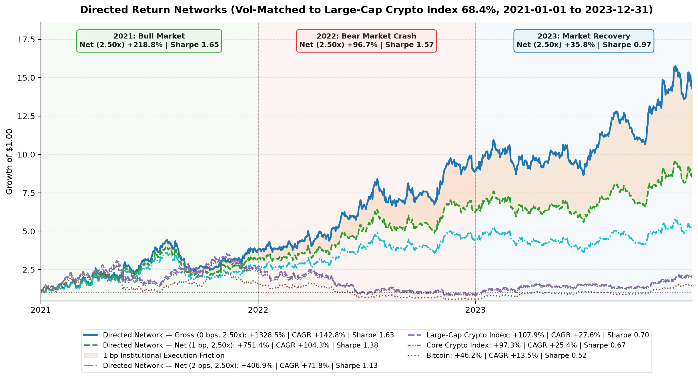
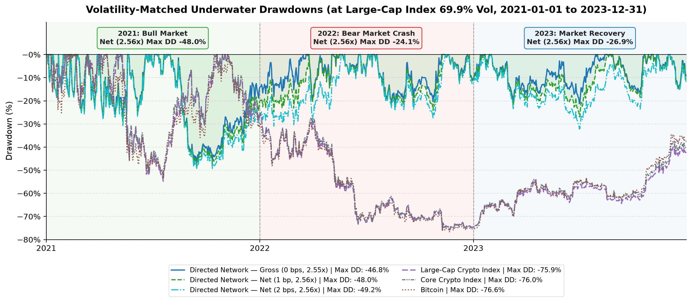

# Directed Return Networks: Path Signatures & Daily Lead-Lag Crypto Strategy

This project tests whether second-order antisymmetric path signatures (Lévy areas) computed over rolling 30-day return trajectories identify cross-asset lead-lag structure across `57` liquid Binance Spot (`USDT`) pairs over 2021–2023 (`1,095` daily `00:00 UTC` observations).

- **Sensitivity to execution friction:** Daily rebalancing generates `1.90x NAV` daily turnover (~694x annualized). Net Sharpe is **1.38** at a `1.0 bp` passive maker fee, falling to `1.13` at `2.0 bps`, `0.36` at `5.0 bps`, and `-0.91` at `10.0 bps`, so viability depends on maker execution fees.
- **Global ranking vs. spectral clustering:** The global leader/follower portfolio delivers **+177.22% Net** (1.38 Sharpe at `1.0 bp`). The spectral-clustering extension using absolute-degree Hermitian normalization underperformed at +1.63% Net (0.16 Sharpe at `1.0 bp`) and is kept as a negative result in [experiments/README.md](experiments/README.md).

## Backtest Results & Transaction-Cost Sensitivity (`2021–2023`)

| Strategy / Benchmark | Cost Tier / Construction | Total Return | CAGR | Annual Vol | Annualized Sharpe ($\sqrt{365.25}$) | Max Drawdown | Daily Turnover |
|:---|:---|---:|---:|---:|---:|---:|---:|
| **Directed Return Network (Global)** | **0.0 bps (Gross)** | +241.33% | +50.61% | 27.38% | **1.63** | -21.15% | 1.90x NAV |
| **Directed Return Network (Global)** | **0.5 bps (VIP Maker)** | +207.61% | +45.47% | 27.37% | **1.51** | -21.50% | 1.90x NAV |
| **Directed Return Network (Global)** | **1.0 bp (Maker Baseline)** | **+177.22%** | **+40.51%** | **27.36%** | **1.38** | **-21.85%** | **1.90x NAV** |
| **Directed Return Network (Global)** | **2.0 bps (Maker/Taker)** | +125.16% | +31.09% | 27.34% | **1.13** | -22.55% | 1.90x NAV |
| **Directed Return Network (Global)** | **5.0 bps (Taker)** | — | +6.46% | — | **0.36** | -29.30% | 1.90x NAV |
| **Directed Return Network (Global)** | **10.0 bps (High Friction)** | — | -24.75% | — | **-0.91** | -67.92% | 1.90x NAV |
| **Clustered Spectral Variant** | **1.0 bp (Exploratory)** | +1.63% | +0.54% | 27.43% | **0.16** | -43.05% | 2.06x NAV |
| **Large-Cap Crypto Index** | 62% BTC / 26% ETH / 12% (8 Alts) | +107.86% | +27.64% | 68.39% | 0.70 | -75.80% | — |
| **Core Crypto Index** | 70% BTC / 30% ETH | +97.26% | +25.43% | 67.72% | 0.67 | -76.27% | — |
| **Bitcoin** | Spot BTC (`100% Long`) | +46.19% | +13.50% | 64.87% | 0.52 | -76.63% | — |

*(Primary institutional tiers `0.0–2.0 bps` are exported directly by `python -m directed_networks.research` into [scores.csv](artifacts/scores.csv); the `5.0` and `10.0 bps` sensitivities reflect higher-friction sweeps across the same `2021–2023` targets.)*





### Historical CAPM Alpha & Market Exposure

Regressing daily strategy returns over 2021–2023 (`1,095` sessions) against the fixed-weight Large-Cap Crypto Index yields:
- Gross (`0.0 bps`): annualized Jensen's alpha +43.92% ($t = 2.78$), $\beta = +0.016$ ($t = 1.29$).
- Net (`1.0 bp`): annualized alpha +36.97% ($t = 2.34$), $\beta = +0.016$.
- Against Bitcoin: +43.84% Gross / +36.89% Net annualized alpha ($\beta = +0.025$).

Because model architecture and evaluation windows were examined on this historical panel and daily OLS $t$-statistics do not adjust for prior selection or serial dependence, these regressions describe historical in-sample excess return rather than a guarantee of out-of-sample alpha.

### Calendar Regimes & Bootstrap Uncertainty

- Calendar breakdown (`1.0 bp` Net / `0.0 bps` Gross): `2021 Bull` +77.98% Net (+90.59% Gross, Sharpe 1.65); `2022 Bear` +35.24% Net (+45.39% Gross, Sharpe 1.57); `2023 Recovery` +15.17% Net (+23.18% Gross, Sharpe 0.97).
- Circular block-bootstrap (2,000 × 30-day blocks): 95% confidence intervals on annualized Sharpe are `[0.74, 2.43]` (Gross `0.0 bps`) and `[0.47, 2.17]` (Net `1.0 bp`), quantifying sampling variability along the realized path.

### Ex-Post Volatility-Matched Comparison (`2.50x` Return Scaling -> `68.39%` Vol)

The base portfolio averages 27.36% annualized volatility (`~+80.6% / -80.6%` netted long/short after overlap between the follower basket and 57-asset universe hedge, or `1.61x NAV` average gross exposure). Multiplying daily returns ex post by `2.50x` aligns volatility to the Large-Cap Crypto Index (68.39%).

At `1.0 bp`, `2.50x` scaling yields **+751.4%** cumulative return (+104.3% CAGR, Sharpe 1.38), `~4.03x NAV` gross exposure, and **-47.2%** max drawdown (vs. +1,328.5% / -46.0% DD at `0 bps`, +406.9% / -48.4% DD at `2.0 bps`, and -75.80% DD for the index). Matching Bitcoin's 64.87% vol requires `2.37x` scaling (+687.8%, `3.82x` gross, -45.3% DD).





## Path Signatures & Portfolio Construction

1. **Antisymmetric Lévy Area Matrix (`W = 30` days):** Given standardized daily returns $z_t \in \mathbb{R}^N$, the pairwise signed area is computed in matrix form as:
   $$A_{i,j} = \frac{1}{2} \sum_{t=1}^T \left( (z_{t-1}^i - z_0^i) \Delta z_t^j - (z_{t-1}^j - z_0^j) \Delta z_t^i \right)$$
   $A$ is strictly skew-symmetric ($A = -A^\top$); positive row sums $\bar{A}_i = \frac{1}{N}\sum_j A_{i,j}$ rank assets by historical lead-lag asymmetry rather than asserting strict causal directionality.
2. **Positions & Neutrality:** The top `20%` by $\bar{A}_i$ form the leader basket and the bottom `20%` form the follower basket. The sign of the leaders' day-$t$ mean return $\mathrm{sgn}(\bar{r}_{\mathrm{leader}, t})$ determines long vs. short orientation of the follower leg balanced against an equal-weighted universe hedge of active assets ($\sum_k w_k = 0$). Exact dollar neutrality does not imply $\beta = 0$.
3. **24/7/365 Annualization:** Crypto spot markets trade continuously, so volatility and Sharpe annualize by $\sqrt{365.25}$ (`mean * 365.25 / (std * sqrt(365.25))`).

## Modeling Assumptions, Data Provenance & Extensions

- **Daily Close-Mark Accounting (`00:00 UTC`):** Signals computed at day-$t$ `00:00 UTC` close are valued at close-to-close transitions under passive Maker fee schedules (`1.0 bp` institutional prime-broker baseline). Modeling intraday limit-order fill rates, queue priority, and latency effects (`experiments.ipynb` shows 1-day delay degrades performance below zero) requires tick-level data.
- **Spot Short-Selling & Financing Scope:** Base-portfolio (`~+80.6% / -80.6%` netted, `1.61x` gross) short legs do not deduct historical exchange margin borrow rates, recall constraints, or perpetual funding rates.
- **Fixed-Weight Benchmarks:** Benchmark baskets use constant weights constructed on the same `00:00 UTC` Binance panel (`data/crypto_daily_panel.csv`, SHA-256 `6c99b9b7...`) rather than external float-adjusted cap indices, avoiding timezone cutoffs and third-party API dependencies.
- **2023 Extension & Delistings (`81` missing terminal entries):** Rows through `2023-11-05` (`2,272` days) are extended by `56` days to `2023-12-31` via Binance Spot REST API (`GET /api/v3/klines`). Delisted symbols (`TOMO` after `2023-11-20`, `PERL` after `2023-12-07`, `BUSD` after `2023-12-15`) are excluded from lookback selection and forward-filled at 0% valuation (`3` stale held marks in 2023) strictly for accounting continuity.

## Reproducibility

```bash
git clone https://github.com/Juliansaiani/directed-return-networks.git
cd directed-return-networks
python -m pip install -r requirements.txt
python -m pip install -e '.[dev]'
python -m pytest -q
python -m directed_networks.research          # primary global runs & artifacts
python -m directed_networks.research --all    # includes spectral clustered variant
```

Primary results are explored in [notebooks/research.ipynb](notebooks/research.ipynb); legacy sweeps and spectral clustering failures are documented in [notebooks/experiments.ipynb](notebooks/experiments.ipynb) and [experiments/README.md](experiments/README.md).

## License

MIT License — Research and 2021–2023 empirical analysis completed and published in 2026. Copyright (c) 2026 Julian Saiani.
